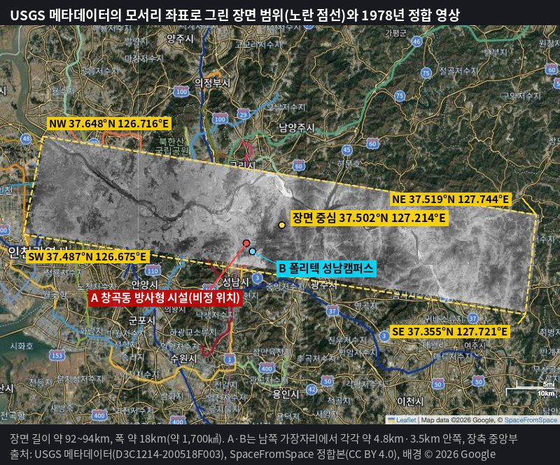
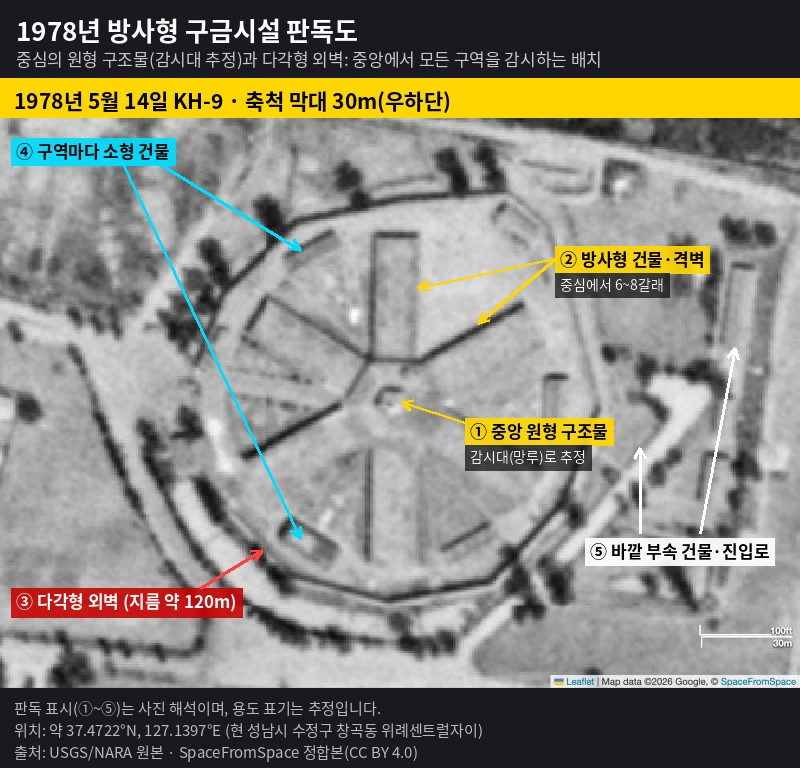
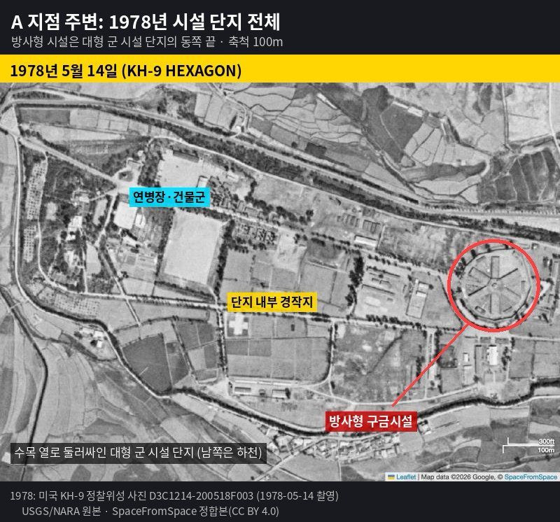
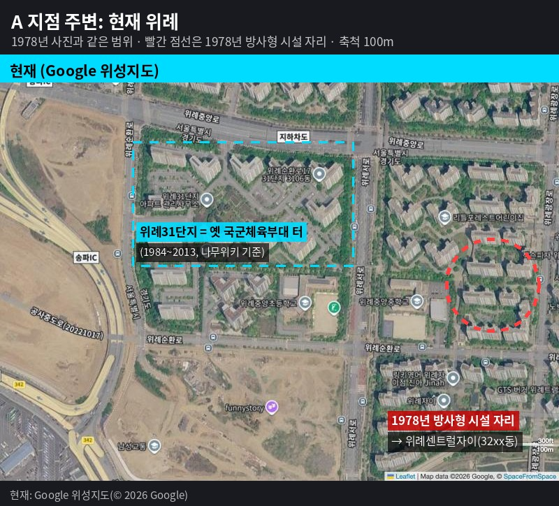
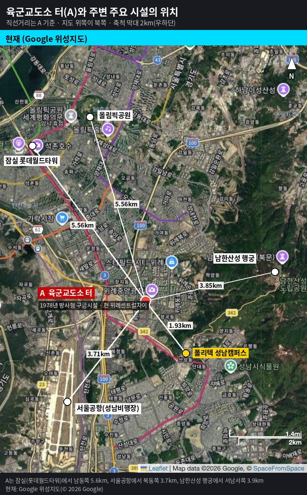
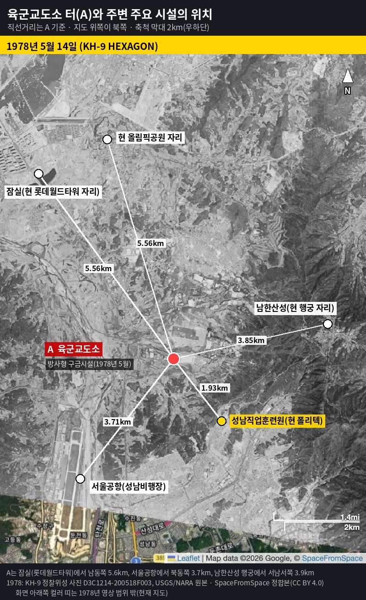

## One-Line Summary

The Namhansanseong Army Prison stood on the site of today's Wirye Central Xi apartment complex in Changgok-dong, Sujeong-gu, Seongnam (37.4722°N, 127.1397°E).

## Introduction

I enlisted in 2007, so I am not of the generation that served while the Army Prison was at Namhansanseong. Even then, though, "Namhansanseong" still circulated as a kind of slang—for the worst place you could end up if your military life went wrong. I used to wonder what on earth you would have to do to fall that far, but it turned out not to be so far away after all. Some of the soldiers who had enlisted before me had already been there and back. Put simply, it was where you were sent if you deliberately maimed someone during your service. Perhaps that is why, in the army, the four syllables of "Namhansanseong" carried a strange power: they were a joke, yet never quite felt like one.

When I finally did visit Namhansanseong, it was, fortunately, in 2010. Since that was after my discharge, "fortunately" is the only word for it. Before my first climb up the mountain, the place felt a little eerie, but once I stood on the ridge, I could not help falling for it. The vast panorama of downtown Seoul, and set against it, the crumbling old fortress walls! From then on, I visited Namhansanseong at least once a year.

A few years later, once I had grown fairly familiar with Namhansanseong, an old question took hold of me. So where, exactly, was this army prison that was supposedly at Namhansanseong? Wherever I looked, there was no massive structure that might once have served as a prison, not even a sign marking its former site. Stranger still, even on an internet awash with grim stories about the prison, the location of the Namhansanseong Army Prison was nowhere to be found. Where was it? Does it still exist? This study identified the site and location of the Army Prison that stood in Seongnam, Gyeonggi Province, from 1962 to 1985—the so-called "Namhansanseong."

## A Place Unrecorded Despite Its Fame

The Army Prison was located in Seongnam for 23 years. Yet I could not confirm its specific location during the Seongnam period from publicly available official sources. This appears to be because, for security reasons, the depiction and public release of military facilities on domestic maps and aerial photographs are often restricted. This gap has been filled by the online encyclopedia Namuwiki. By 2015 at the latest, Namuwiki's 'Sanseong-dong (Seongnam)' article was stating that the Army Prison had stood on the site of Korea Polytechnic I College's Seongnam Campus. That statement survived several rounds of revisions without ever citing a source, but was later deleted. Nor could I find any academic study dealing directly with the prison's location during its Seongnam period. Even so, it is hard to understand how a state correctional facility as well known as the Namhansanseong Army Prison can, as of 2026, have no known location. I therefore investigated the location of the Namhansanseong Army Prison, as groundwork for future research on the particular nature of military facilities and prisons and on how state records treat such facilities.

## Literature Review

Comparing the official history of the Army Prison with Namuwiki's account—the only source that addresses the prison's location—yields the following.

### 1. History of the Army Prison

| Date | Event |
| ---------- | ----------------------------------- |
| 1962.6.28 | Moved to Seongnam, Gyeonggi Province (then Gwangju-gun); split into the First and Second Army Prisons |
| 1979.7.1 | First and Second Army Prisons merged; renamed the Army Prison |
| 1985.10.22 | Moved to Janghowon-eup, Icheon, Gyeonggi Province |
| 2014.11.21 | Reorganized as the Armed Forces Prison |

The official history gives the Army Prison's 1962 destination only as "Seongnam (then Gwangju-gun)." It does not specify the location down to the dong (洞) or ri (里) level, nor does it give the locations of the two prisons before their 1979 merger.

### 2. What Namuwiki Says

| Article | Rev. | Date | Content |
| -------------- | ---- | ---------- | ---------------------------------------- |
| Enhawiki Mirror 'Sujeong-gu' | — | Unknown | States the prison was "on the site of the Polytechnic Seongnam Campus until the '70s" |
| Namuwiki 'Sanseong-dong (Seongnam)' | r1 | 2015 | Same statement, no source |
| Namuwiki 'Armed Forces Prison' | r156 | 2018.2.17 | Footnote added identifying the Seongnam-era site as "Changseong Middle School and the Polytechnic," no source |
| Namuwiki 'Armed Forces Prison' | r331 | 2021.4.17 | Above footnote deleted |
| Namuwiki 'Sanseong-dong (Seongnam)' | r45 | 2023.11.26 | "Until the '70s" changed to "until 1985," no source |

The first revision (r1) of the 'Sanseong-dong (Seongnam)' article stated that "the Army Prison was on the site of Korea Polytechnic I College's Seongnam Campus until the '70s." The same sentence also appears in the Enhawiki Mirror's 'Sujeong-gu' article, so the claim appears to predate Namuwiki.

From the start, this statement contradicted the official history (relocation in 1985). The 2023 revision merely brought the year into line with the official history; it added no evidence for the location. The 2018 footnote narrowed the location down to "Changseong Middle School and the Polytechnic," but it, too, offered no evidence, and it was deleted in 2021.

### 3. Korea Polytechnics (Formerly the Seongnam Vocational Training Institute): History and Site

How, then, does Namuwiki's account compare with the history of Korea Polytechnics (formerly the Seongnam Vocational Training Institute)? First, that history is as follows.

| Date      | Main events                |
| ------- | -------------------- |
| 1976.12 | Seongnam Vocational Training Institute founded as an incorporated foundation      |
| 1977.5  | Reorganized as a public vocational training corporation        |
| 1977.6  | Entrance ceremony for the first cohort              |
| 1979.3  | Grinding program established              |
| 1982.3  | Integrated as an affiliate of the Korea Vocational Training Management Agency |
| 1982.11 | Seongnam Regional Skills Development Center launched       |
| 1987.3  | Reorganized into professional-level programs; entrance ceremony for the first cohort   |
| 1990.3  | Heat-treatment program established             |

Source: HRD Korea (1993: 552).

Korea Polytechnics' founding year, 1976, falls within the period when the Army Prison was in Seongnam.

What is more, the book's list of vocational training institutes (HRD Korea, 1993: 104) also gives June 1977 as the opening date of the Seongnam Vocational Training Institute. Its address in 1992 was "4 Sanseong-dong, Sujeong-gu, Seongnam-si, Gyeonggi-do" (HRD Korea, 1993: 540).

### 4. Conclusions from the Literature Review

Nowhere in Korea Polytechnics' institutional history is there any record of relocation, land purchase, annexation of adjacent land, or large-scale new construction. Nor do the board resolutions recorded in the same book include any item concerning the Seongnam site. The claim that Korea Polytechnics was built on the site of the Army Prison is therefore hard to sustain.

## Imagery Review

### 1. About the Image

* SpaceFromSpace: [https://spacefromspace.com/declassified-satellite-images/seoul-south-korea-19780514-d3c1214200518f003/](https://spacefromspace.com/declassified-satellite-images/seoul-south-korea-19780514-d3c1214200518f003/)
* Soar: [https://soaratlas.com/maps/asia-korea-republic-of-south-korea-seoul-south-korea-1978-05-14-141644?pos=37.4720790938207%2C127.1311314975609%2C15.78](https://soaratlas.com/maps/asia-korea-republic-of-south-korea-seoul-south-korea-1978-05-14-141644?pos=37.4720790938207%2C127.1311314975609%2C15.78)

The image analyzed here was taken by the high-resolution panoramic camera of the U.S. KH-9 HEXAGON reconnaissance satellite. The KH-9 was an American photographic reconnaissance satellite operated from 1971 to 1984. It took stereo photographs with two panoramic cameras, and the exposed film was sent back to Earth in recovery capsules ("buckets") (National Museum of the U.S. Air Force, n.d.; Designation-Systems.net, n.d.).

Most of this camera's imagery was declassified in 2011 under Executive Order 12951. The U.S. Geological Survey (USGS) Earth Resources Observation and Science (EROS) Center makes it available as the "Declassified Satellite Imagery 3" collection (DOI: 10.5066/F7WD3Z10). The collection comprises some 14,000 rolls and more than 670,000 scenes (USGS EROS, n.d.-a). The image's entity ID is D3C1214-200518F003 (mission 1214), and it was taken on May 14, 1978. Its ground resolution, as stated by the provider, is about 0.8 m.

The image covers a strip extending from the mouth of the Han River through downtown Seoul and Seongnam to the area east of Namhansanseong. It covers old downtown Seongnam and the area of today's Wirye New Town. For the analysis, I used the georeferenced version (CC BY 4.0) that SpaceFromSpace published after fitting the USGS original to map coordinates in QGIS. The reference for comparison is Google's satellite map, viewed in October 2026.

I chose this image for the following reasons.

* **Timing:** It was taken right in the middle of the period when the prison was in Seongnam (1962–1985).
* **Resolution:** Facilities can be identified.
* **Limitations of alternative sources:** The National Geographic Information Platform (국토정보플랫폼), V-World, the Gyeonggi Real Estate Portal, and Seoul's aerial photography service could not be accessed through automated means in this study. Kakao Map provides imagery only from the 2000s onward. The originals on USGS EarthExplorer require registration.

This was the only free, publicly available, high-resolution declassified image covering the area that I could find.

**The image's metadata are as follows.**

| Field | Value | Meaning |
| -------- | -------------------------------------------------------------------------- | ---------------------------------------------------------------------- |
| Entity ID | D3C1214-200518F003 | A concatenation of collection D3, status C (complete), mission 1214, bucket 2, operation number 00518, camera F, and frame 003 |
| Acquisition date | 1978/05/14 | — |
| Mission | 1214-2 | Bucket 2 (film-return capsule) of mission 1214 |
| Camera | F | High-resolution surveillance camera (forward). A is aft; T is the terrain-mapping camera |
| Camera resolution | 2 to 4 feet | About 0.6–1.2 m |
| Operation number | 518 | Number that marks the start and end of an imaging sequence within a mission |
| Frame number | 3 | Position within the film roll |
| Image type / polarity | Black and white, negative | — |
| Film type | 6 | Film width/length code. The code definitions are not published, but the example given is "6.5 in × variable," so it appears to be 6.5 inches wide (inferred) |
| Generation | 2 | Second-generation duplicate film held by EROS; lower resolution than the original held by the National Archives and Records Administration (NARA) |
| Download | 1 | Already scanned and available for immediate download |
| Center coordinates | 37.502°N, 127.214°E | — |
| Corner coordinates | NW 37.648/126.716, NE 37.519/127.744, SE 37.355/127.721, SW 37.487/126.675 | — |

### 2. Image Interpretation

Not long after I began examining the image, I came across a strikingly unusual facility. It had a polygonal outer wall about 120–130 m in diameter, a circular central structure, and radial partition walls. It stood on the site of today's Wirye Central Xi complex in Changgok-dong, Sujeong-gu, Seongnam (37.4722°N, 127.1397°E).

| Element       | Observation                           | Measurement (approx.)           |
| -------- | ------------------------------- | ----------------- |
| Outer wall       | Closed polygonal outer wall with an inner perimeter road              | About 120–130 m in diameter     |
| Central structure   | Circular structure at the center of the facility (presumably a watchtower)          | About 6–7 m in diameter         |
| Radial elements   | Buildings and partition walls extending from the center, dividing the interior into fan-shaped sections | 6–8 arms             |
| Buildings within sections  | A small building in each fan-shaped section                  | —                 |
| Outlying ancillary facilities | Ancillary buildings and an access road east of the outer wall               | About 200 m overall, including the outer fence |

The facility's structure matches the description in *Reflections from Prison* (『감옥으로부터의 사색』) by Shin Young-bok, who was once imprisoned in the Army Prison.

> “\[…\] As its nickname, 'the Hexagon' (六角), suggests, this Namhansanseong Army Prison has six long cell blocks (舍棟) radiating in six directions from the center, and it is very important that none of the six blocks faces due east, west, south, or north.
>
> In a word, inside this hexagon one's sense of direction blurs before one knows it. I cannot say whether the design was deliberately planned to produce this effect or whether it was mere chance, but one ends up unable to take a sure bearing on any of the four cardinal directions. To this loss of direction add days that are machine-like in their monotony and routine. Every single day is hard indeed. One comes to long for something new—fresh drive, creativity—and it only grows harder."
>
> *Reflections from Prison*, pp. 54–55

A radial layout from which every section can be surveyed from a single point is a typical structure of modern prisons premised on central surveillance, as at Seodaemun Prison. Schools, military barracks, reservoirs, and antenna facilities do not take this form. As the image below shows, this becomes even clearer when the presumed Army Prison facility is compared with the nearby facilities presumed to be military installations.

It is therefore highly likely that this facility, which combines an outer wall, a central surveillance structure, and radial housing sections, was the Namhansanseong Army Prison.

## Conclusion

The Namhansanseong Army Prison stood across the road, due west of the central plaza of today's Wirye New Town. And so the terror of the past lies buried beneath the apartments of a new town.

## Appendix

* **Coordinates:** 37.4722°N, 127.1397°E
* **Today:** Near Buildings 3214 and 3215 of Wirye Central Xi (Buildings 3201–3219, 1,413 households, first occupied in June 2017) in Changgok-dong, Sujeong-gu, Seongnam-si, Gyeonggi-do. It lies east of Wirye Jungang Middle School.
* **Western part of the compound:** Today's Wirye Complex 31. It is the former site of the Armed Forces Athletic Corps (founded in 1984; moved to Mungyeong in September 2013).
* **Administrative history:** Changgok-ri was incorporated into Jungbu-myeon, Gwangju-gun, in 1914, came under the Seongnam Branch Office in 1971, and became part of Seongnam City in 1973 (administrative dong, or *haengjeong-dong*: Bokjeong-dong). In 2018, the legal dongs (*beopjeong-dong*) in the Seongnam portion of Wirye were consolidated into Changgok-dong.

| Reference point          | Direction (from reference point)        | Straight-line distance    |
| ------------ | --------- | ------- |
| Namhansanseong Haenggung (temporary royal palace)      | West (slightly southwest) | About 3.8 km |
| South Gate of Namhansanseong (Jihwamun) | Almost due west    | About 3.7 km |
| Namhansanseong Station (남한산성입구역)      | Northwest       | About 2.9 km |
| Korea Polytechnics Seongnam Campus    | Northwest       | About 1.9 km |

The prison stood at the western foot of the ridge (Cheongnyangsan) on which Namhansanseong sits. It lay west of the fortress walls and northwest of downtown Seongnam.

## References

**1. Books and Institutional Publications**

* 신영복 (Shin Young-bok) (1988). 『감옥으로부터의 사색』 (*Reflections from Prison*). 서울: 햇빛출판사. (Expanded edition: 돌베개, 1998)
* 한국산업인력공단 (HRD Korea) (1993). 『한국산업인력공단 10년사』 (*A Ten-Year History of HRD Korea*). 서울: 한국산업인력공단.

**2. Imagery**

* U.S. Geological Survey. *Declassified Satellite Imagery 3*, Entity ID D3C1214-200518F003 (KH-9 HEXAGON, 1978-05-14).
* SpaceFromSpace. "Seoul, South Korea – 1978-05-14 – KH-9." [https://spacefromspace.com/declassified-satellite-images/seoul-south-korea-19780514-d3c1214200518f003/](https://spacefromspace.com/declassified-satellite-images/seoul-south-korea-19780514-d3c1214200518f003/) (accessed 2026.10.14)
* Soar. "Seoul, South Korea – 1978-05-14." [https://soar.earth/maps/asia-korea-republic-of-south-korea-seoul-south-korea-1978-05-14-141644](https://soar.earth/maps/asia-korea-republic-of-south-korea-seoul-south-korea-1978-05-14-141644) (accessed 2026.10.14)
* Google. Google satellite map, Seongnam-si, Gyeonggi-do area. (accessed 2026.10.14)

**3. Press and Interviews**

* 김성수(2016.1.18). 「쇠귀 신영복...'한 평 감옥'에서 '더불어숲'을 보다」 ("Soegwi Shin Young-bok: Seeing a 'Forest Together' from a 'One-Pyeong Cell'"). 『뉴스타파』 (*Newstapa*). [https://newstapa.org/article/5ajM4](https://newstapa.org/article/5ajM4)
* 김영태(2016.1.16). 「고 신영복 교수 연보」 ("A Chronology of the Late Professor Shin Young-bok"). 『CBS노컷뉴스』 (*CBS NoCut News*). [https://nocutnews.co.kr/news/4533717](https://nocutnews.co.kr/news/4533717)
* 노정용(2008.7.30). 「\[화제의 책\] 청구회 추억(신영복 지음/돌베개)」 ("\[Book in Focus\] *Memories of the Cheonggu Club* by Shin Young-bok, Dolbegae"). 『파이낸셜뉴스』 (*The Financial News*). [https://www.fnnews.com/news/200807291605443341](https://www.fnnews.com/news/200807291605443341)
* 박인규(2016.1.21). 「신영복의 '사색'은 어떻게 세상에 나왔나」 ("How Shin Young-bok's *Reflections* Came into the World"). 『프레시안』 (*Pressian*). [https://pressian.com/pages/articles/132716](https://pressian.com/pages/articles/132716)
* 서울신문 (*Seoul Shinmun*) (2017.12.12). 「폐교 앞둔 영성여중 '성남문화예술 교육지원센터' 탈바꿈」 ("Yeongseong Girls' Middle School, Facing Closure, to Become the 'Seongnam Culture and Arts Education Support Center'"). [https://m.go.seoul.co.kr/news/2017/12/12/20171212500130](https://m.go.seoul.co.kr/news/2017/12/12/20171212500130)
* 시사저널 (*Sisa Journal*) (1995.5.11). 「'남한산성'을 아십니까?」 ("Do You Know 'Namhansanseong'?"). [https://www.sisajournal.com/news/articleView.html?idxno=80259](https://www.sisajournal.com/news/articleView.html?idxno=80259)
* 이지훈(2024.11.3). 「\[천자춘추\] 남한산성의 추억」 ("\[Cheonja Chunchu column\] Memories of Namhansanseong"). 『경기일보』 (*Kyeonggi Ilbo*). [https://kyeonggi.com/article/20241103580298](https://kyeonggi.com/article/20241103580298)
* 한홍구(2006.6.22). 「\[대담\] 감옥으로부터의 인간개조」 ("\[Conversation\] Remaking a Human Being from Prison"). 『한겨레21』 (*Hankyoreh 21*). Included in the Shin Young-bok Archive. [https://www.shinyoungbok.net/shinyoungbok/archive/srch/ArchiveNewSrchView.do?i_id=810](https://www.shinyoungbok.net/shinyoungbok/archive/srch/ArchiveNewSrchView.do?i_id=810)

**4. Online Sources** (all accessed 2026.10.13–14)

* 나무위키 (Namuwiki). '국군교도소' (Armed Forces Prison). [https://namu.wiki/w/%EA%B5%AD%EA%B5%B0%EA%B5%90%EB%8F%84%EC%86%8C](https://namu.wiki/w/%EA%B5%AD%EA%B5%B0%EA%B5%90%EB%8F%84%EC%86%8C) (r156: [https://namu.wiki/w/%EA%B5%AD%EA%B5%B0%EA%B5%90%EB%8F%84%EC%86%8C?uuid=a2fd77e3-cd3e-4c80-9fa8-0241d9b6dad5](https://namu.wiki/w/%EA%B5%AD%EA%B5%B0%EA%B5%90%EB%8F%84%EC%86%8C?uuid=a2fd77e3-cd3e-4c80-9fa8-0241d9b6dad5) ; r331: [https://namu.wiki/w/%EA%B5%AD%EA%B5%B0%EA%B5%90%EB%8F%84%EC%86%8C?uuid=eceda129-65bf-44c0-8ebd-b11b9e3fabc8](https://namu.wiki/w/%EA%B5%AD%EA%B5%B0%EA%B5%90%EB%8F%84%EC%86%8C?uuid=eceda129-65bf-44c0-8ebd-b11b9e3fabc8))
* 나무위키 (Namuwiki). '국군체육부대' (Armed Forces Athletic Corps). [https://namu.wiki/w/%EA%B5%AD%EA%B5%B0%EC%B2%B4%EC%9C%A1%EB%B6%80%EB%8C%80](https://namu.wiki/w/%EA%B5%AD%EA%B5%B0%EC%B2%B4%EC%9C%A1%EB%B6%80%EB%8C%80)
* 나무위키 (Namuwiki). '산성동(성남)' (Sanseong-dong, Seongnam). r1: [https://namu.wiki/w/%EC%82%B0%EC%84%B1%EB%8F%99%28%EC%84%B1%EB%82%A8%29?uuid=17027227-2e98-45f7-bd56-a0687299be35](https://namu.wiki/w/%EC%82%B0%EC%84%B1%EB%8F%99%28%EC%84%B1%EB%82%A8%29?uuid=17027227-2e98-45f7-bd56-a0687299be35) ; r45: [https://namu.wiki/w/%EC%82%B0%EC%84%B1%EB%8F%99%28%EC%84%B1%EB%82%A8%29?uuid=46b87a3c-9ea2-421a-bbb6-cd64d8f6dcd4](https://namu.wiki/w/%EC%82%B0%EC%84%B1%EB%8F%99%28%EC%84%B1%EB%82%A8%29?uuid=46b87a3c-9ea2-421a-bbb6-cd64d8f6dcd4)
* 나무위키 (Namuwiki). '위례신도시' (Wirye New Town). [https://namu.wiki/w/%EC%9C%84%EB%A1%80%EC%8B%A0%EB%8F%84%EC%8B%9C](https://namu.wiki/w/%EC%9C%84%EB%A1%80%EC%8B%A0%EB%8F%84%EC%8B%9C)
* 나무위키 (Namuwiki). '창곡동(성남)' (Changgok-dong, Seongnam). [https://namu.wiki/w/%EC%B0%BD%EA%B3%A1%EB%8F%99%28%EC%84%B1%EB%82%A8%29](https://namu.wiki/w/%EC%B0%BD%EA%B3%A1%EB%8F%99%28%EC%84%B1%EB%82%A8%29)
* 리치고 (Richgo). '창곡동 위례센트럴자이' (Wirye Central Xi, Changgok-dong). [https://m.richgo.ai/realty/danji/a3jRVir](https://m.richgo.ai/realty/danji/a3jRVir)
* 서울특별시 주택분야 누리집 (Seoul Metropolitan Government housing website). 항공사진서비스 안내 (Guide to the aerial photography service). [https://news.seoul.go.kr/citybuild/archives/30970](https://news.seoul.go.kr/citybuild/archives/30970)
* 엔하위키 미러 (Enhawiki Mirror) '수정구' (Sujeong-gu) (archived copy on GitHub). [https://github.com/sunghyuk/enha/blob/master/mirror/%EC%88%98%EC%A0%95%EA%B5%AC.md](https://github.com/sunghyuk/enha/blob/master/mirror/%EC%88%98%EC%A0%95%EA%B5%AC.md)
* 위키백과 (Korean Wikipedia). '감옥으로부터의 사색' (*Reflections from Prison*). [https://ko.wikipedia.org/wiki/%EA%B0%90%EC%98%A5%EC%9C%BC%EB%A1%9C%EB%B6%80%ED%84%B0%EC%9D%98_%EC%82%AC%EC%83%89](https://ko.wikipedia.org/wiki/%EA%B0%90%EC%98%A5%EC%9C%BC%EB%A1%9C%EB%B6%80%ED%84%B0%EC%9D%98_%EC%82%AC%EC%83%89)
* 위키백과 (Korean Wikipedia). '국군교도소' (Armed Forces Prison). [https://ko.wikipedia.org/wiki/%EA%B5%AD%EA%B5%B0%EA%B5%90%EB%8F%84%EC%86%8C](https://ko.wikipedia.org/wiki/%EA%B5%AD%EA%B5%B0%EA%B5%90%EB%8F%84%EC%86%8C)

20261015
