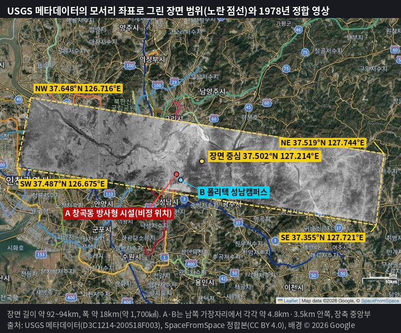
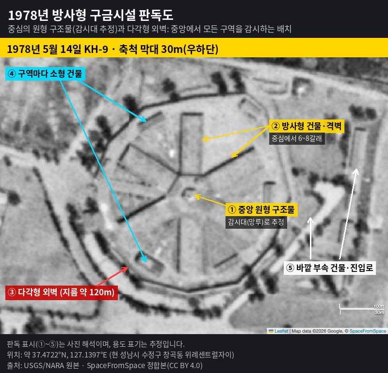
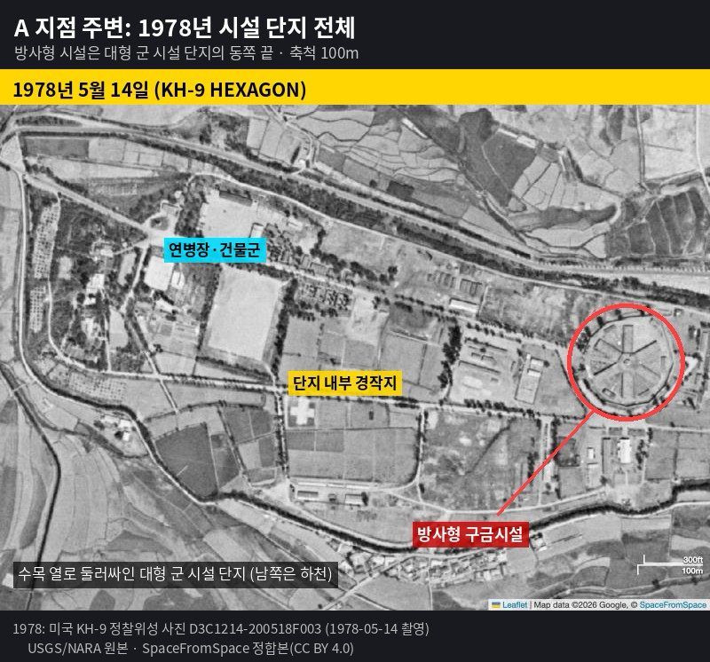
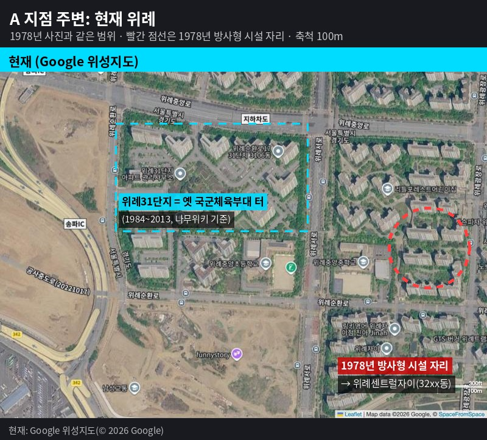
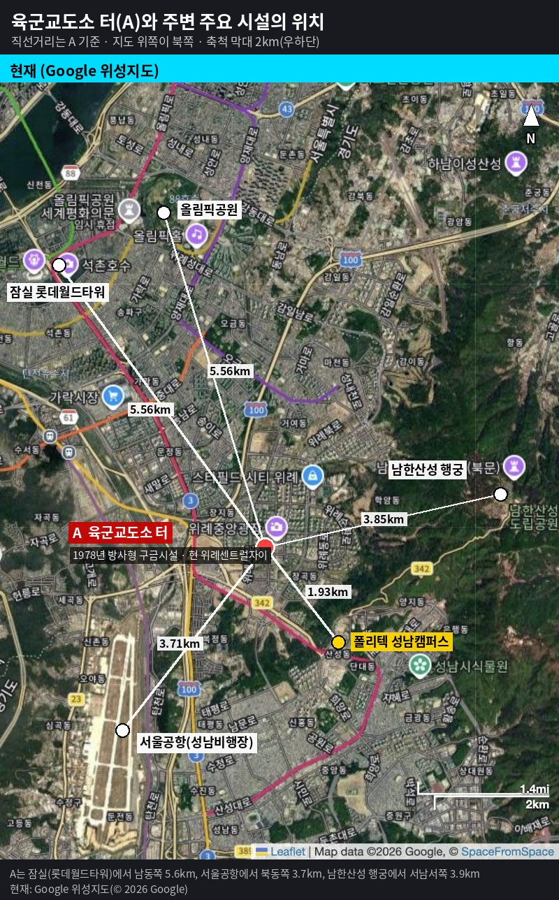
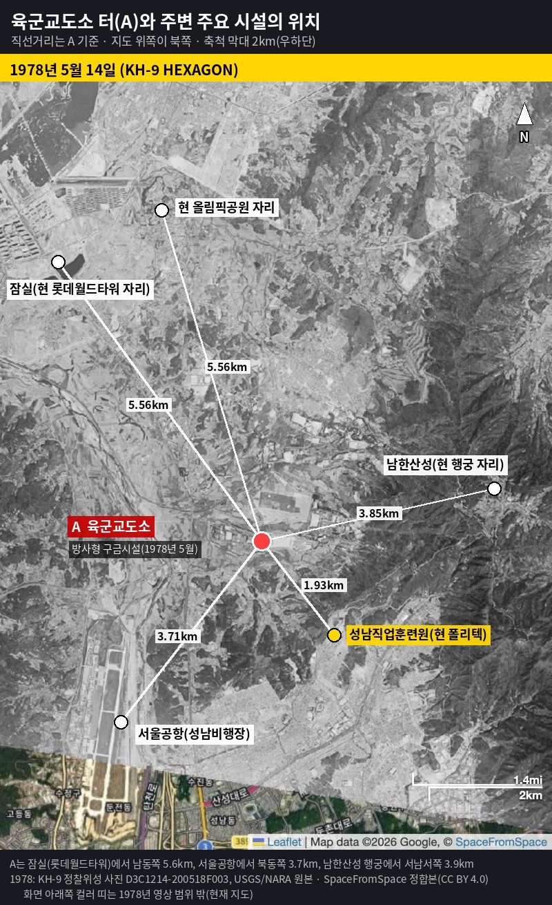

## 1줄 요약

남한산성 육군교도소의 위치는 현재의 성남시 수정구 창곡동 위례센트럴자이 단지 자리(북위 37.4722°, 동경 127.1397°)이다.

## 서론

나는 07년 군번인지라 남한산성에 육군교도소가 있던 세대는 아니다. 하지만 당시에도 남한산성은 여전히 일종의 은어로 통했다. 군생활 꼬이면 도달할 수 있는 최악의 장소로서 말이다. 대체 무슨 짓을 하면 거기까지 추락할까 싶었으나, 알고 보니 그리 멀지도 않았다. 내 윗 군번에서는 이미 다녀온 사람도 있었으니까. 간단히 말해서 군 생활 중 고의로 사람 하나 병신 만들면 가게 되는 곳이었다. 그래서인지 군대에서 ‘남한산성’ 4글자는 농담이지만 농담 같지 않은 마력을 지닌 단어였다.

마침내 내가 남한산성을 방문한 날은 다행스럽게도 2010년이었다. 전역 이후였으니 다행이라 표현할 수 밖에. 처음 산에 오르기 전에는 다소 스산했지만, 막상 능선에 서니 반할 수 밖에 없었다. 서울 도심의 거대한 풍광하며, 그에 대비되어 허물어진 옛 성벽이라니. 이후 나는 적어도 매년 남한산성을 찾게 되었다.

그로부터 몇 해가 지나 남한산성에 대하여 제법 익숙해지자 나는 오래된 옛 생각에 사로잡혔다. 그래서 남한산성에 있다는 육군교도소는 대체 어디에 있다는 건가? 어디를 둘러봐도 교도소로 쓰였을 법한 거대 구조물은 없었고, 그 옛 터를 가리키는 안내판조차 보이지 않았다. 더욱 기이한 것은 교도소에 대한 흉흉한 이야기가 넘실대는 인터넷에서조차 남한산성 육군교도소의 위치는 찾을 수 없었다. 그곳은 어디였을까? 지금도 남아있을까? 이 연구는 1962년부터 1985년까지 경기도 성남에 있던 육군교도소, 이른바 '남한산성'의 입지와 위치를 밝혔다.

## 유명세에도 불구하고 기록되지 않은 곳

육군교도소가 성남에 위치한 기간은 23년에 달한다. 하지만 성남 시기 교도소의 구체적인 입지는 공개된 공식 자료로는 확인할 수 없었다. 군사시설은 보안상 국내 지도와 항공사진에서 표기와 공개가 제한되는 경우가 많기 때문으로 보인다. 이 공백은 온라인 백과사전 나무위키의 서술이 메워 왔다. 나무위키 '산성동(성남)' 문서는 늦어도 2015년부터 육군교도소가 한국폴리텍1대학 성남캠퍼스 자리에 있었다고 적었다. 이 서술은 출처 없이 여러 차례 수정을 거치며 유지되었으나, 이후 삭제되었다. 한편 성남 시기 교도소의 입지를 직접 다룬 학술 연구 역시 확인할 수 없었다. 그렇다 해도 남한산성 육군교도소 만큼이나 저명한 국가 교정 시설이 2026년 현재 그 위치조차 알 수 없다는 점은 이해하기 어렵다. 이에 군 시설과 교도소의 특수성, 그리고 이러한 시설에 대한 국가 기록의 태도에 대한 연구에 선행 작업으로 남한산성 육군교도소의 위치를 조사했다.

## 문헌 검토

육군교도소의 위치를 다룬 유일한 자료인 나무위키의 서술과 육군교도소의 연혁를 비교하면 다음과 같다.

### 1. 육군교도소 연혁

| 시기 | 내용 |
| ---------- | ----------------------------------- |
| 1962.6.28 | 경기도 성남(당시 광주군)으로 이전, 육군 제1·2교도소로 분할 |
| 1979.7.1 | 제1·2교도소 통합, 육군교도소로 개칭 |
| 1985.10.22 | 경기도 이천시 장호원읍으로 이전 |
| 2014.11.21 | 국군교도소로 개편 |

연혁은 1962년의 육군교도소 이전지를 '성남(당시 광주군)'으로만 적고 있다. 동(洞)·리(里) 단위 위치나 1979년 통합 전 두 교도소의 위치는 밝히지 않았다.

### 2. 나무위키에서의 관련 서술

| 문서 | 판 | 날짜 | 내용 |
| -------------- | ---- | ---------- | ---------------------------------------- |
| 엔하위키 미러 '수정구' | — | 시점 미상 | '70년대까지 폴리텍 성남캠퍼스 자리' 서술 |
| 나무위키 '산성동(성남)' | r1 | 2015 | 같은 서술, 출처 없음 |
| 나무위키 '국군교도소' | r156 | 2018.2.17 | 성남 시기 자리를 '창성중과 폴리텍'으로 설명하는 각주 추가, 출처 없음 |
| 나무위키 '국군교도소' | r331 | 2021.4.17 | 위 각주 삭제 |
| 나무위키 '산성동(성남)' | r45 | 2023.11.26 | '70년대까지'를 '1985년까지'로 수정, 출처 없음 |

'산성동(성남)' 문서의 첫 판(r1)은 "육군교도소가 70년대까지 한국폴리텍1대학 성남캠퍼스 자리에 있었다"고 적었다. 같은 문장이 엔하위키 미러의 '수정구' 문서에도 있어, 나무위키 이전부터 전해진 서술로 보인다.

이 서술은 처음부터 공식 연혁(1985년 이전)과 맞지 않았다. 2023년의 수정은 연도만 공식 연혁에 맞추었을 뿐, 위치의 근거는 보태지 않았다. 2018년의 각주는 위치를 '창성중과 폴리텍'으로 구체화하였으나 역시 근거를 제시하지 않았고 2021년에 삭제되었다.

### 3. 한국폴리텍대학(구 성남직업훈련원)의 연혁과 부지

그렇다면 나무위키의 서술과 한국폴리텍대학(구 성남직업훈련원)을 비교하면 어떨까? 우선 한국폴리텍대학의 연혁은 다음과 같다.

| 연월      | 주요 내용                |
| ------- | -------------------- |
| 1976.12 | 재단법인 성남직업훈련원 설립      |
| 1977.5  | 공공직업훈련법인으로 개편        |
| 1977.6  | 제1기 입학식              |
| 1979.3  | 연삭공과 신설              |
| 1982.3  | 한국직업훈련관리공단 산하기관으로 통합 |
| 1982.11 | 성남지역 기능개발센터 발족       |
| 1987.3  | 전문과정으로 개편, 제1기 입학식   |
| 1990.3  | 열처리공과 신설             |

자료: 한국산업인력공단(1993: 552).

한국폴리텍대학의 설립 연도인 76년은 육군교도소가 성남에 위치하던 시기와 겹친다.

뿐만 아니라 직업훈련원 일람표(한국산업인력공단, 1993: 104)도 성남직업훈련원의 개원 시기를 1977년 6월로 적었다. 1992년 주소는 '경기도 성남시 수정구 산성동 4'다(한국산업인력공단, 1993: 540).

### 4. 문헌검토 결론

한국폴리텍대학 연혁 전체에 이전, 부지 매입, 인접 부지 편입, 대규모 신축에 관한 기록은 없다. 같은 책의 이사회 의결 사항에서도 성남 부지 관련 안건은 확인되지 않았다. 따라서 한국폴리텍대학이 육군교도소의 부지 위에 세워졌다는 주장은 성립하기 어렵다.

## 영상 검토

### 1. 영상에 대하여

* SpaceFromSpace: [https://spacefromspace.com/declassified-satellite-images/seoul-south-korea-19780514-d3c1214200518f003/](https://spacefromspace.com/declassified-satellite-images/seoul-south-korea-19780514-d3c1214200518f003/)
* Soar: [https://soaratlas.com/maps/asia-korea-republic-of-south-korea-seoul-south-korea-1978-05-14-141644?pos=37.4720790938207%2C127.1311314975609%2C15.78](https://soaratlas.com/maps/asia-korea-republic-of-south-korea-seoul-south-korea-1978-05-14-141644?pos=37.4720790938207%2C127.1311314975609%2C15.78)

분석 영상은 미국 KH-9 HEXAGON 정찰위성의 고해상도 파노라마 카메라 영상이다. KH-9는 1971~1984년 운용된 미국의 사진정찰위성이다. 두 대의 파노라마 카메라로 입체 촬영을 하였고, 촬영한 필름은 회수 캡슐(버킷)에 담아 지상으로 내려보냈다(National Museum of the U.S. Air Force, n.d.; Designation-Systems.net, n.d.).

이 카메라의 영상은 대부분 2011년 행정명령 12951에 따라 기밀 해제되었다. 미국 지질조사국(USGS) 지구자원관측과학센터(EROS)는 이를 'Declassified Satellite Imagery 3' 자료군(DOI: 10.5066/F7WD3Z10)으로 공개한다. 이 자료군은 약 1만 4천 롤, 67만 장면 이상으로 이루어져 있다(USGS EROS, n.d.-a). 영상 식별번호는 D3C1214-200518F003(임무 번호 1214)이고, 촬영일은 1978년 5월 14일이다. 지상 해상도는 제공처 표기로 약 0.8m다.

영상은 한강 하구에서 서울 도심, 성남, 남한산성 동쪽까지 띠 모양으로 이어진다. 성남 구시가지와 오늘날의 위례신도시 일대가 여기에 들어 있다. 분석에는 SpaceFromSpace가 USGS 원본을 QGIS로 지도 좌표에 맞춰 공개한 정합본(CC BY 4.0)을 사용하였다. 비교 기준은 2026년 10월에 열람한 Google 위성지도다.

이 영상을 택한 이유는 다음과 같다.

* **시기:** 교도소가 성남에 있던 기간(1962~1985)의 한가운데에 촬영되었다.
* **해상도:** 시설 판독이 가능하다.
* **대안 자료의 제약:** 국토정보플랫폼, 브이월드, 경기부동산포털, 서울시 항공사진서비스는 이 연구에서 자동 열람이 불가능하였다. 카카오맵은 2000년대 이후 영상만 제공한다. USGS EarthExplorer 원본은 회원 가입이 필요하다.

이 지역을 덮는 무료 공개 고해상도 기밀해제 영상으로는 이 한 장만 확인되었다.

**영상의 메타데이터는 다음과 같다.**

| 항목 | 값 | 의미 |
| -------- | -------------------------------------------------------------------------- | ---------------------------------------------------------------------- |
| 영상 식별번호 | D3C1214-200518F003 | 자료군 D3, 상태 C(완료), 임무 1214, 버킷 2, 작전 번호 00518, 카메라 F, 프레임 003을 이어 붙인 번호 |
| 촬영일 | 1978/05/14 | — |
| 임무 번호 | 1214-2 | 임무 1214의 2번 버킷(필름 회수 캡슐) |
| 카메라 | F | 고해상도 감시 카메라(전방). A는 후방, T는 지형 매핑 카메라 |
| 카메라 해상도 | 2 to 4 feet | 약 0.6~1.2m |
| 작전 번호 | 518 | 한 임무 안에서 촬영 시퀀스의 시작과 끝을 구분하는 번호 |
| 프레임 번호 | 3 | 필름 롤 안의 위치 |
| 영상 유형·극성 | 흑백, 음화 | — |
| 필름 유형 | 6 | 필름 폭·길이 코드. 코드 정의는 공개되지 않았고, 예시가 ‘6.5인치×가변'이어서 6.5인치 폭으로 보입니다(추정) |
| 세대 | 2 | EROS가 보관한 2세대 복제 필름. 국립문서기록관리청(NARA) 소장 원본보다 해상도가 낮음 |
| 다운로드 | 1 | 이미 스캔되어 바로 내려받을 수 있음 |
| 중심 좌표 | 37.502°N, 127.214°E | — |
| 모서리 좌표 | NW 37.648/126.716, NE 37.519/127.744, SE 37.355/127.721, SW 37.487/126.675 | — |

### 2. 영상 판독

영상을 확인하기 시작한지 얼마 되지 않아 놀랍도록 특이한 시설을 발견할 수 있었다. 이 시설은 지름 약 120~130m의 다각형 외벽, 중앙 원형 구조물, 방사형 격벽을 갖추고 있었다. 위치는 현재의 성남시 수정구 창곡동 위례센트럴자이 단지 자리(북위 37.4722°, 동경 127.1397°)이다.

| 요소       | 관찰 내용                           | 계측값(근사)           |
| -------- | ------------------------------- | ----------------- |
| 외벽       | 다각형 폐쇄형 외벽, 안쪽 순환로              | 지름 약 120~130m     |
| 중앙 구조물   | 시설 중심의 원형 구조물(감시대로 추정)          | 지름 약 6~7m         |
| 방사형 요소   | 중심에서 뻗은 건물과 격벽, 내부를 부채꼴 구역으로 분할 | 6~8갈래             |
| 구역 내 건물  | 부채꼴 구역마다 소형 건물                  | —                 |
| 외곽 부속 시설 | 외벽 동쪽의 부속 건물과 진입로               | 바깥 담 포함 전체 약 200m |

시설의 구조는 육군교도소 수감자였던 신영복의 『감옥으로부터의 사색』에 나오는 묘사와 일치한다.

> ‘(전략) 이 남한산성 육군교도소는 6각(六角)이라는 별명에서 알 수 있듯이 중앙을 중심으로 6개의 긴 사동(舍棟)이 6개의 방향으로 뻗어 있는데, 6개의 사동 중의 어느 사동도 동・서・남・북의 정방향이 아니라는 사실이 매우 중요하다.
>
> 한마디로 이 6각 속에서는 어느새 방향감각이 흐려진다. 이 점을 노려 계획된 설계인지 우연인지는 알 수 없지만 동서남북 중의 어느 하나도 확실하게 방향을 가늠할 수가 없게 되고 만다. 이러한 방향감각의 상실에다 기계처럼 단조롭고 습관화된 나날들. 실로 힘든 하루하루가 아닐 수 없다. 무엇인가 새로운 의욕과 창의, 이런 것들이 무척 아쉬워지며, 점점 더 어려워지는 것이다.’
>
> 감옥으로부터의 사색. p54~55

한 지점에서 모든 구역을 내려다보는 방사형 배치는 서대문형무소처럼 중앙 감시를 전제로 한 근대 감옥의 전형적인 구조다. 학교, 군 막사, 저수조, 안테나 시설에서는 이런 형태가 나오지 않는다. 이 점은 아래 영상에서 볼 수 있듯이 육군교도소 추정 시설 인근의 군부대 시설(추정)과 비교하면 더욱 분명해진다.

따라서 외벽, 중앙 감시 구조물, 방사형 수용 구획이 함께 나타나는 이 시설이 남한산성 육군교도소였을 가능성은 대단히 높다.

## 결론

남한산성 육군교도소는 현재의 위례신도시 중앙광장의 정서 방향 길건너편에 위치했다. 과거의 공포는 이렇게 신도시 아파트 아래에 묻혔다.

## 부록

* **좌표:** 북위 37.4722°, 동경 127.1397°
* **현재:** 경기도 성남시 수정구 창곡동 위례센트럴자이(3201~3219동, 1,413세대, 2017년 6월 입주)의 3214·3215동 부근이다. 위례중앙중학교 동쪽에 해당한다.
* **단지 서쪽 부분:** 지금의 위례31단지다. 국군체육부대(1984년 창설, 2013년 9월 문경 이전)의 옛 부지다.
* **행정구역 변천:** 창곡리는 1914년 광주군 중부면에 편입됐고, 1971년 성남출장소, 1973년 성남시(행정동은 복정동)가 됐다. 2018년 위례 성남 지역의 법정동이 창곡동으로 통일됐다.

| 기준점          | 방향        | 직선거리    |
| ------------ | --------- | ------- |
| 남한산성 행궁      | 서쪽(약간 남서) | 약 3.8km |
| 남한산성 남문(지화문) | 거의 정서쪽    | 약 3.7km |
| 남한산성입구역      | 북서쪽       | 약 2.9km |
| 폴리텍 성남캠퍼스    | 북서쪽       | 약 1.9km |

교도소는 남한산성이 있는 산줄기(청량산)의 서쪽 기슭에 있었다. 성곽을 기준으로는 서쪽, 성남 시가지를 기준으로는 북서쪽이다.

## 참고문헌

**1. 단행본·기관 자료**

* 신영복(1988). 『감옥으로부터의 사색』. 서울: 햇빛출판사. (증보판: 돌베개, 1998)
* 한국산업인력공단(1993). 『한국산업인력공단 10년사』. 서울: 한국산업인력공단.

**2. 영상 자료**

* U.S. Geological Survey. *Declassified Satellite Imagery 3*, Entity ID D3C1214-200518F003 (KH-9 HEXAGON, 1978-05-14).
* SpaceFromSpace. "Seoul, South Korea – 1978-05-14 – KH-9." [https://spacefromspace.com/declassified-satellite-images/seoul-south-korea-19780514-d3c1214200518f003/](https://spacefromspace.com/declassified-satellite-images/seoul-south-korea-19780514-d3c1214200518f003/) (2026.10.14. 열람)
* Soar. "Seoul, South Korea – 1978-05-14." [https://soar.earth/maps/asia-korea-republic-of-south-korea-seoul-south-korea-1978-05-14-141644](https://soar.earth/maps/asia-korea-republic-of-south-korea-seoul-south-korea-1978-05-14-141644) (2026.10.14. 열람)
* Google. Google 위성지도, 경기도 성남시 일대. (2026.10.14. 열람)

**3. 언론·대담**

* 김성수(2016.1.18). 「쇠귀 신영복...'한 평 감옥'에서 '더불어숲'을 보다」. 『뉴스타파』. [https://newstapa.org/article/5ajM4](https://newstapa.org/article/5ajM4)
* 김영태(2016.1.16). 「고 신영복 교수 연보」. 『CBS노컷뉴스』. [https://nocutnews.co.kr/news/4533717](https://nocutnews.co.kr/news/4533717)
* 노정용(2008.7.30). 「\[화제의 책\] 청구회 추억(신영복 지음/돌베개)」. 『파이낸셜뉴스』. [https://www.fnnews.com/news/200807291605443341](https://www.fnnews.com/news/200807291605443341)
* 박인규(2016.1.21). 「신영복의 '사색'은 어떻게 세상에 나왔나」. 『프레시안』. [https://pressian.com/pages/articles/132716](https://pressian.com/pages/articles/132716)
* 서울신문(2017.12.12). 「폐교 앞둔 영성여중 '성남문화예술 교육지원센터' 탈바꿈」. [https://m.go.seoul.co.kr/news/2017/12/12/20171212500130](https://m.go.seoul.co.kr/news/2017/12/12/20171212500130)
* 시사저널(1995.5.11). 「'남한산성'을 아십니까?」. [https://www.sisajournal.com/news/articleView.html?idxno=80259](https://www.sisajournal.com/news/articleView.html?idxno=80259)
* 이지훈(2024.11.3). 「\[천자춘추\] 남한산성의 추억」. 『경기일보』. [https://kyeonggi.com/article/20241103580298](https://kyeonggi.com/article/20241103580298)
* 한홍구(2006.6.22). 「\[대담\] 감옥으로부터의 인간개조」. 『한겨레21』. 신영복 아카이브 수록. [https://www.shinyoungbok.net/shinyoungbok/archive/srch/ArchiveNewSrchView.do?i_id=810](https://www.shinyoungbok.net/shinyoungbok/archive/srch/ArchiveNewSrchView.do?i_id=810)

**4. 온라인 자료** (모두 2026.10.13~14. 열람)

* 나무위키. '국군교도소'. [https://namu.wiki/w/%EA%B5%AD%EA%B5%B0%EA%B5%90%EB%8F%84%EC%86%8C](https://namu.wiki/w/%EA%B5%AD%EA%B5%B0%EA%B5%90%EB%8F%84%EC%86%8C) (r156: [https://namu.wiki/w/%EA%B5%AD%EA%B5%B0%EA%B5%90%EB%8F%84%EC%86%8C?uuid=a2fd77e3-cd3e-4c80-9fa8-0241d9b6dad5](https://namu.wiki/w/%EA%B5%AD%EA%B5%B0%EA%B5%90%EB%8F%84%EC%86%8C?uuid=a2fd77e3-cd3e-4c80-9fa8-0241d9b6dad5) ; r331: [https://namu.wiki/w/%EA%B5%AD%EA%B5%B0%EA%B5%90%EB%8F%84%EC%86%8C?uuid=eceda129-65bf-44c0-8ebd-b11b9e3fabc8](https://namu.wiki/w/%EA%B5%AD%EA%B5%B0%EA%B5%90%EB%8F%84%EC%86%8C?uuid=eceda129-65bf-44c0-8ebd-b11b9e3fabc8))
* 나무위키. '국군체육부대'. [https://namu.wiki/w/%EA%B5%AD%EA%B5%B0%EC%B2%B4%EC%9C%A1%EB%B6%80%EB%8C%80](https://namu.wiki/w/%EA%B5%AD%EA%B5%B0%EC%B2%B4%EC%9C%A1%EB%B6%80%EB%8C%80)
* 나무위키. '산성동(성남)'. r1: [https://namu.wiki/w/%EC%82%B0%EC%84%B1%EB%8F%99%28%EC%84%B1%EB%82%A8%29?uuid=17027227-2e98-45f7-bd56-a0687299be35](https://namu.wiki/w/%EC%82%B0%EC%84%B1%EB%8F%99%28%EC%84%B1%EB%82%A8%29?uuid=17027227-2e98-45f7-bd56-a0687299be35) ; r45: [https://namu.wiki/w/%EC%82%B0%EC%84%B1%EB%8F%99%28%EC%84%B1%EB%82%A8%29?uuid=46b87a3c-9ea2-421a-bbb6-cd64d8f6dcd4](https://namu.wiki/w/%EC%82%B0%EC%84%B1%EB%8F%99%28%EC%84%B1%EB%82%A8%29?uuid=46b87a3c-9ea2-421a-bbb6-cd64d8f6dcd4)
* 나무위키. '위례신도시'. [https://namu.wiki/w/%EC%9C%84%EB%A1%80%EC%8B%A0%EB%8F%84%EC%8B%9C](https://namu.wiki/w/%EC%9C%84%EB%A1%80%EC%8B%A0%EB%8F%84%EC%8B%9C)
* 나무위키. '창곡동(성남)'. [https://namu.wiki/w/%EC%B0%BD%EA%B3%A1%EB%8F%99%28%EC%84%B1%EB%82%A8%29](https://namu.wiki/w/%EC%B0%BD%EA%B3%A1%EB%8F%99%28%EC%84%B1%EB%82%A8%29)
* 리치고. '창곡동 위례센트럴자이'. [https://m.richgo.ai/realty/danji/a3jRVir](https://m.richgo.ai/realty/danji/a3jRVir)
* 서울특별시 주택분야 누리집. 항공사진서비스 안내. [https://news.seoul.go.kr/citybuild/archives/30970](https://news.seoul.go.kr/citybuild/archives/30970)
* 엔하위키 미러 '수정구'(GitHub 보존본). [https://github.com/sunghyuk/enha/blob/master/mirror/%EC%88%98%EC%A0%95%EA%B5%AC.md](https://github.com/sunghyuk/enha/blob/master/mirror/%EC%88%98%EC%A0%95%EA%B5%AC.md)
* 위키백과. '감옥으로부터의 사색'. [https://ko.wikipedia.org/wiki/%EA%B0%90%EC%98%A5%EC%9C%BC%EB%A1%9C%EB%B6%80%ED%84%B0%EC%9D%98_%EC%82%AC%EC%83%89](https://ko.wikipedia.org/wiki/%EA%B0%90%EC%98%A5%EC%9C%BC%EB%A1%9C%EB%B6%80%ED%84%B0%EC%9D%98_%EC%82%AC%EC%83%89)
* 위키백과. '국군교도소'. [https://ko.wikipedia.org/wiki/%EA%B5%AD%EA%B5%B0%EA%B5%90%EB%8F%84%EC%86%8C](https://ko.wikipedia.org/wiki/%EA%B5%AD%EA%B5%B0%EA%B5%90%EB%8F%84%EC%86%8C)

20261015
